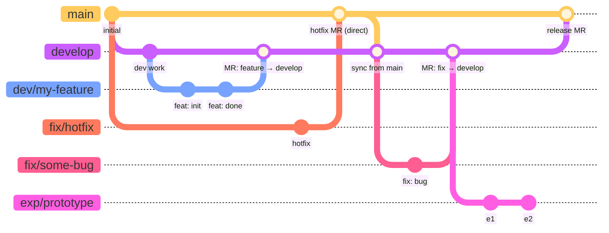

# Contributing

## Branching Strategy

### Persistent Branches
- `main` — production-ready code
- `develop` — integration branch for ongoing work

### Topic Branches
- `dev/<feature>` — feature branches (e.g., `dev/fix-convergence`)
- `fix/<issue>` — bug fixes
- `exp/<name>` — experimental / throwaway work

All merges into `main` must be peer reviewed via a GitLab Merge Request (or GitHub Pull Request).
Topic branch work is normally merged into `develop` first; direct merges to
`main` require explicit sign-off from the lead developer.
Case-specific work may be done directly on `develop` with lead-developer
approval.

### Branching Strategy Diagram

> **Note on diagram format**: Standard Markdown cannot embed draw.io (`.drawio`)
> files. The diagram below uses [Mermaid](https://mermaid.js.org/), which
> renders natively on GitLab, GitHub, and VS Code (with the Mermaid extension).



**Key rules encoded in the diagram:**

| Branch | Created from | Merges into | Requires MR? |
|---|---|---|---|
| `develop` | `main` | `main` | Yes |
| `dev/<feature>` | `develop` or `main` | `develop` or `main`* | Yes |
| `fix/<issue>` | `develop` or `main` | `develop` or `main`* | Yes |
| `exp/<name>` | anywhere | typically abandoned | — |

\* Direct merge to `main` requires lead-developer approval.

### Merge Requirements

**Tests must pass** before any Merge Request can be merged into `main` or `develop`.

All branches **must be up to date** with their target branch before they can be merged. This ensures that integration conflicts are resolved locally by the author.

#### Merging strategies
Depending on the target branch, use the following merge strategies:

- **Merging a topic branch (`dev/*`, `fix/*`) into `develop` or `main`**:
  - *Note: In most cases, this is done via a GitLab Merge Request or GitHub Pull Request.*
  1. If you want to preserve the branch history, **create a lightweight
    git tag** of the branch *before* merging (see [Tagging deleted
    branches](#tagging-deleted-branches)).
  1. Perform a **Squash merge**, making sure to check the box to delete the
    source branch after the merge.
- **Merging `develop` into `main`**:
  - *Note: In most cases, this is done via a GitLab Merge Request or GitHub Pull Request.*
  1. Perform a **Standard merge** (often called "Merge commit" or "Create a merge commit") to preserve the squashed history of the individual features.

To enforce these rules centrally, a project Maintainer should configure the GitLab project settings once after the repository is created. See [Setup — GitLab project settings](#gitlab-project-settings).

## Setup

### GitLab project settings

A project **Maintainer** should apply these settings once after creating the repository. They cannot be set by Developers and should not be automated by scripts or agents.

**Settings → General → Merge requests:**

| Setting | Value |
|---|---|
| Merge method | Merge commit |
| Squash commits | Encourage |
| ☑ Pipelines must succeed | checked |
| ☑ Delete source branch | checked |

**Settings → Repository → Protected branches** — add each branch:

| Branch | Allowed to merge | Allowed to push and force push |
|---|---|---|
| `main` | Maintainers | No one |
| `develop` | Maintainers | Developers + Maintainers |

`main` is push-protected to ensure all changes arrive via merge request. `develop` allows direct pushes for minor integration work with lead-developer approval (see [Branching Strategy](#branching-strategy)).

### Project setup

[Install `just`](https://just.systems/man/en/packages.html) if you haven't already:
- macOS: `brew install just`
- Linux: see [just installation docs](https://just.systems/man/en/packages.html)
- Windows: `winget install Casey.Just` or `scoop install just`

Run once per clone — handles `uv sync`, direnv approval (macOS/Linux), and git hook installation:

```bash
just setup
```

> **Windows note:** prek hooks run as shell scripts — [Git for Windows](https://git-scm.com/download/win) (which includes Git Bash) must be installed.

The hooks enforce code quality and prevent accidental direct commits or pushes to `main` and `develop`. They are split by stage to keep development fast:
- **`pre-commit`:** Runs fast linting and formatting (Ruff).
- **`pre-push`:** Runs heavier validation (Mypy type checking, Pytest) only when sharing code with the remote.

## CI/CD

The template includes a pre-configured `.gitlab-ci.yml` that automatically handles lint, type-check, test, and branch-tagging stages — no per-developer or per-project runner setup required.

### GEG Group Runner (GCP)

GEG projects use a shared GitLab runner hosted on GCP. The runner is an `e2-small` spot VM in `europe-west6` (Zurich), registered as a group runner under the GEG GitLab group, and runs jobs in isolated Docker containers.

To use it, set the tag and a suitable image in your `.gitlab-ci.yml`:

```yml
default:
  tags:
    - gcp-runner
  image: ghcr.io/astral-sh/uv:python3.11-bookworm  # or whichever image your jobs need
```

The runner also picks up **untagged jobs**, so existing pipelines with no `tags:` block will use it automatically.

Common images:

| Use case | Image |
|---|---|
| Python + uv (lint, test, typecheck) | `ghcr.io/astral-sh/uv:python3.11-bookworm` |
| OpenTofu / Terraform | `ghcr.io/opentofu/opentofu:latest` |
| Git operations only (e.g. tagging) | `alpine:latest` + `apk add -q --no-cache git` |

Runner infrastructure is managed in [geg-core-infra](https://gitlab.ethz.ch/geg/geg-infra/geg-core-infra) — see `environments/dev/gitlab-runner.tf` and `docs/ci.md` for architecture details and the operational runbook (token rotation, resizing, etc.).

## Changelog

[`CHANGELOG.md`](CHANGELOG.md) follows the [Keep a Changelog](https://keepachangelog.com/en/1.1.0/)
convention, using the standard KaC entry types:

| Category | When to use |
|---|---|
| `Added` | New user-visible functionality |
| `Changed` | Internal restructuring or behaviour change |
| `Deprecated` | Features that will be removed in a future version |
| `Removed` | Features removed in this version |
| `Fixed` | Defect corrections |
| `Security` | Security-related fixes |

Entries live under a `## [In Development]` heading at the top of the file
until a release is cut. Each `[In Development]` block may optionally note the
associated MR number in the **body** (not the heading) for traceability.

> **Public release note**: if/when this project is released publicly and adopts
> [Semantic Versioning](https://semver.org/), rename the `[In Development]`
> heading to `[Unreleased]` and update the footer link label to match. This
> aligns with the standard KaC convention and is expected by most changelog
> tooling (e.g. `git-cliff`, `standard-changelog`).

### When to add an entry

| Project phase | Merges into `develop` | Merges into `main` | Releases |
|---|---|---|---|
| **Pre-1.0** (current) | Optional | **Required** | **Required** |
| **Post-1.0** | Optional | Optional | **Required** |

**Pre-1.0 rationale**: Before the first release the changelog is the primary
record of what {{ cookiecutter.project_name }} is becoming. Every merge into `main` represents a
meaningful, reviewable change that an end-user or future contributor will want
to understand, so an entry is expected.

**Post-1.0 rationale**: Once releases are the primary communication mechanism,
individual merges need not be documented — but every release *must* have a
complete entry so that upgrading users know exactly what changed.

### Format

The changelog is structured around **merge requests into `main`**, not releases.
Keep a `## [In Development]` stub at the very top for ongoing work. Right before a MR
is merged into `main`, convert it into a named section:

```markdown
## [In Development]

*(Nothing yet.)*

---

## MR !<N> — YYYY-MM-DD: <short title>

Optional summary paragraph.
[Link to MR !<N>](<gitlab MR URL>)

### Added
- **<Thing>** — description.

### Fixed
- **<Thing>** — description.
```

When the first public release is cut, group the relevant MR sections under a
`## [1.0.0] — YYYY-MM-DD` heading, rename `[In Development]` to `[Unreleased]`
(see note above), and update the footer comparison links at the bottom of `CHANGELOG.md`.

### Tagging deleted branches

GitLab prunes branch refs when branches are deleted, which would break
`CHANGELOG.md` comparison links. To preserve a permanent pointer to where a
branch landed, the CI pipeline automatically creates a lightweight git tag
named `bak/<branch-name>` at the end of every successful merge request
pipeline — right before the reviewer clicks merge and the squash happens.

> **Prerequisite**: The `tag_branch` CI job needs a Project Access Token with
> `write_repository` scope to push tags. Create one under
> **Settings → Access Tokens → Add new token**:
> - **Token name**: `GITLAB_PUSH_TOKEN`
> - **Description**: `allows gitlab runner to tag branches`
> - **Role**: Developer
> - **Scope**: `write_repository`
>
> GitLab shows the token value only once — copy it immediately and add it as
> a CI/CD variable under **Settings → CI/CD → Variables** with these settings:
> - **Description**: `allows gitlab runner to tag branches`
> - **Key**: `GITLAB_PUSH_TOKEN`
> - **Value**: paste the token here
> - **Visibility**: Masked (redacts the value from job logs)
> - **Protect variable**: unchecked (protected variables are not injected into
>   unprotected MR branches, so the job would never see the token)
>
> You do not need to store the token value anywhere else.

If you ever need to do this manually (e.g. CI is unavailable):

```bash
git tag bak/fix/some-bug                              # lightweight tag with bak/ prefix
git push origin refs/tags/bak/fix/some-bug            # push the tag explicitly
git push origin --delete refs/heads/fix/some-bug      # delete branch explicitly
```

This is a well-established practice — unlike branches, tags are static pointers
to a specific commit. This ensures the commit remains reachable even after the
branch ref disappears.

> **Convention**: prefix *release* tags with `v` (e.g. `v1.2.0`) and
> branch-preservation tags with `bak/` (e.g. `bak/fix/some-bug`).

The `CHANGELOG.md` footer will then look like:

```markdown
[Unreleased]: https://github.com/your-org/your-repo/compare/v1.2.0...HEAD
[1.2.0]: https://github.com/your-org/your-repo/compare/v1.1.0...v1.2.0
[1.1.0]: https://github.com/your-org/your-repo/releases/tag/v1.1.0
```
