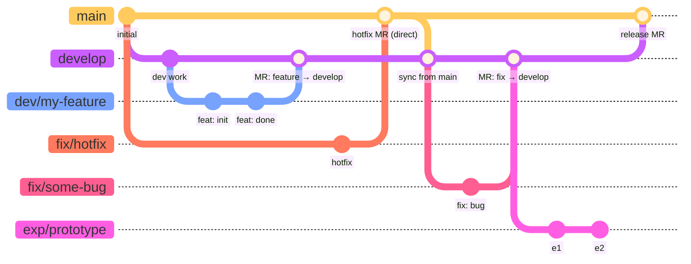

# Contributing

## Branching Strategy

### Persistent Branches
- `main` — production-ready code
- `develop` — integration branch for ongoing work

### Topic Branches
- `dev/<feature>` — feature branches (e.g., `dev/fix-convergence`)
- `fix/<issue>` — bug fixes
- `exp/<name>` — experimental / throwaway work

All merges into `main` must be peer reviewed via a GitLab Merge Request.
Topic branch work is normally merged into `develop` first; direct merges to
`main` require explicit sign-off from the lead developer.
Case-specific work may be done directly on `develop` with lead-developer
approval.

### Branching Strategy Diagram

> **Note on diagram format**: Standard Markdown cannot embed draw.io (`.drawio`)
> files. The diagram below uses [Mermaid](https://mermaid.js.org/), which
> renders natively on GitLab, GitHub, and VS Code (with the Mermaid extension).



**Key rules encoded in the diagram:**

| Branch | Created from | Merges into | Requires MR? |
|---|---|---|---|
| `develop` | `main` | `main` | Yes |
| `dev/<feature>` | `develop` or `main` | `develop` or `main`* | Yes |
| `fix/<issue>` | `develop` or `main` | `develop` or `main`* | Yes |
| `exp/<name>` | anywhere | typically abandoned | — |

\* Direct merge to `main` requires lead-developer approval.

### Merge Requirements

All branches **must be up to date** with their target branch before they can be merged. This ensures that integration conflicts are resolved locally by the author before the code lands in a persistent branch.

**Tests must pass** before any Merge Request can be merged into `main` or `develop`.

To enforce these rules centrally, project maintainers should configure GitLab:
1. Go to **Settings** > **Merge requests**.
2. Under **Merge method**, select **Fast-forward merge** (or **Merge commit with semi-linear history**). This structurally prevents merging if the source branch is behind the target branch.
*(Alternatively, check "Merge requests must be up to date before merging" under **Merge checks**, depending on your GitLab version).*
3. Under **Merge checks**, check **Pipelines must succeed**.

## Setup

After cloning, install the git hooks using `pre-commit`:
```bash
uv run pre-commit install
uv run pre-commit install --hook-type pre-push
```

This enforces code quality and prevents accidental direct commits or pushes to `main` and `develop`.

## Changelog

[`CHANGELOG.md`](CHANGELOG.md) follows the [Keep a Changelog](https://keepachangelog.com/en/1.1.0/)
convention, using the standard KaC entry types:

| Category | When to use |
|---|---|
| `Added` | New user-visible functionality |
| `Changed` | Internal restructuring or behaviour change |
| `Deprecated` | Features that will be removed in a future version |
| `Removed` | Features removed in this version |
| `Fixed` | Defect corrections |
| `Security` | Security-related fixes |

Entries live under a `## [In Development]` heading at the top of the file
until a release is cut. Each `[In Development]` block may optionally note the
associated MR number in the **body** (not the heading) for traceability.

> **Public release note**: if/when this project is released publicly and adopts
> [Semantic Versioning](https://semver.org/), rename the `[In Development]`
> heading to `[Unreleased]` and update the footer link label to match. This
> aligns with the standard KaC convention and is expected by most changelog
> tooling (e.g. `git-cliff`, `standard-changelog`).

### When to add an entry

| Project phase | Merges into `develop` | Merges into `main` | Releases |
|---|---|---|---|
| **Pre-1.0** (current) | Optional | **Required** | **Required** |
| **Post-1.0** | Optional | Optional | **Required** |

**Pre-1.0 rationale**: Before the first release the changelog is the primary
record of what TANGO is becoming. Every merge into `main` represents a
meaningful, reviewable change that an end-user or future contributor will want
to understand, so an entry is expected.

**Post-1.0 rationale**: Once releases are the primary communication mechanism,
individual merges need not be documented — but every release *must* have a
complete entry so that upgrading users know exactly what changed.

### Format

The changelog is structured around **merge requests into `main`**, not releases.
Keep a `## [In Development]` stub at the very top for ongoing work. Right before a MR
is merged into `main`, convert it into a named section:

```markdown
## [In Development]

*(Nothing yet.)*

---

## MR !<N> — YYYY-MM-DD: <short title>

Optional summary paragraph.
[Link to MR !<N>](<gitlab MR URL>)

### Added
- **<Thing>** — description.

### Fixed
- **<Thing>** — description.
```

When the first public release is cut, group the relevant MR sections under a
`## [1.0.0] — YYYY-MM-DD` heading, rename `[In Development]` to `[Unreleased]`
(see note above), and update the [footer comparison
links](#tagging-deleted-branches) at the bottom of `CHANGELOG.md`.

### Tagging deleted branches

GitLab prunes branch refs when branches are deleted, which would break
`CHANGELOG.md` comparison links. To preserve a permanent pointer to where a
branch landed, **create a lightweight git tag immediately before deleting the
branch**:

```bash
git tag fix/some-bug                              # lightweight tag, same name as branch
git push origin refs/tags/fix/some-bug            # push the tag explicitly
git push origin --delete refs/heads/fix/some-bug  # delete branch explicitly
# (using refs/tags/ and refs/heads/ avoids ambiguity since tag and branch share the name)
```

This is a well-established practice — unlike branches, tags are static pointers
to a specific commit. This ensures the commit remains reachable even after the
branch ref disappears.

> **Convention**: prefix *release* tags with `v` (e.g. `v1.2.0`) to
> distinguish them from branch-preservation tags (e.g. `fix/some-bug`).

The `CHANGELOG.md` footer will then look like:

```markdown
[Unreleased]: https://github.com/your-org/your-repo/compare/v1.2.0...HEAD
[1.2.0]: https://github.com/your-org/your-repo/compare/v1.1.0...v1.2.0
[1.1.0]: https://github.com/your-org/your-repo/releases/tag/v1.1.0
```
